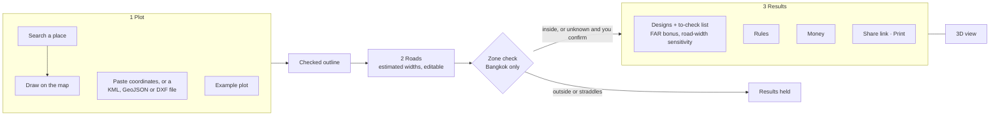
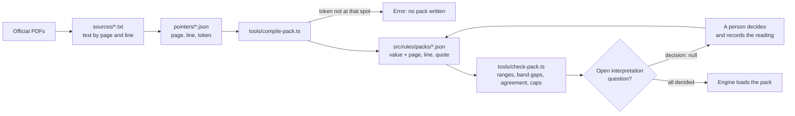
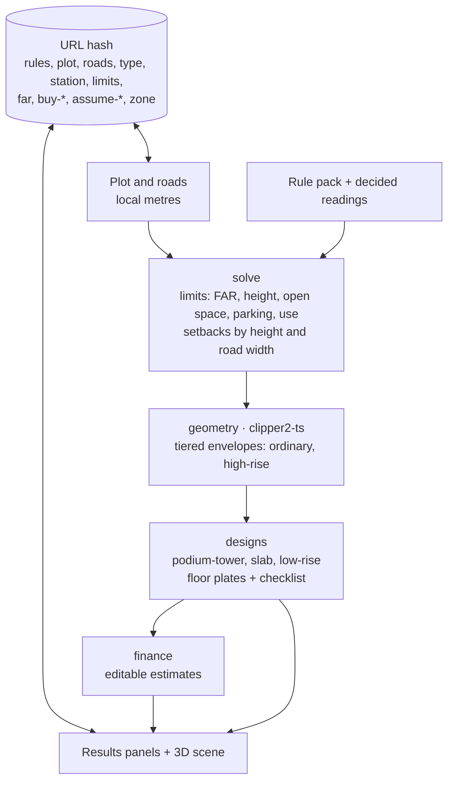
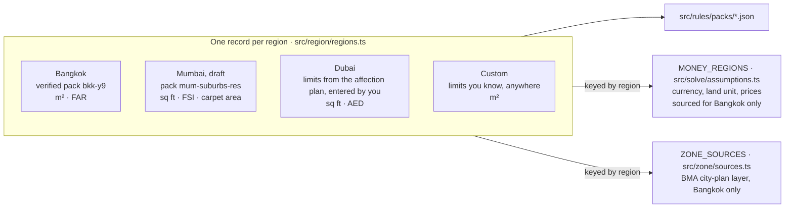
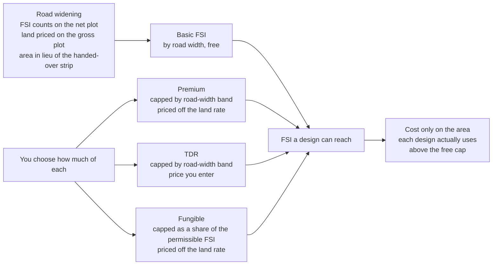
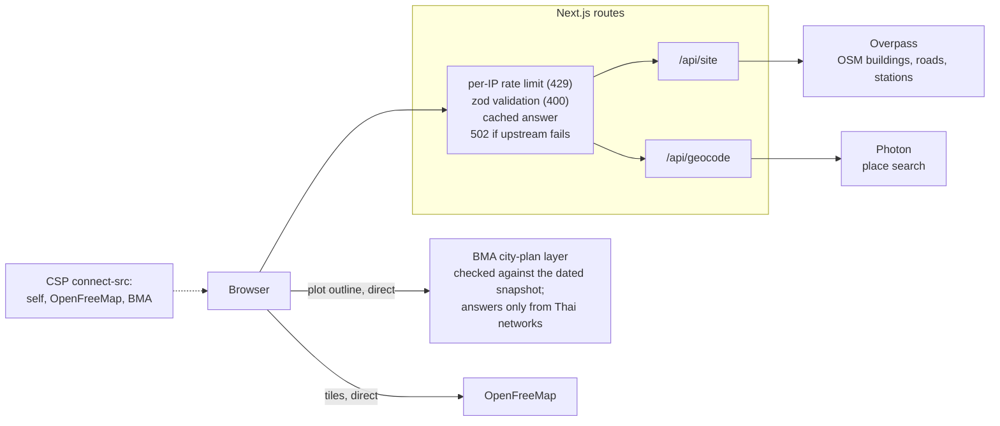
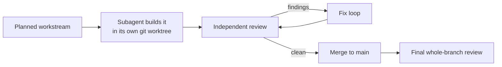

<p align="center"></p>

<h1 align="center">Plotwise</h1>

<p align="center">See what a Bangkok plot can hold before you buy it: the floor area the rules allow, concept designs in 3D, what is left to check and a rough first cost.</p>

<p align="center"><a href="https://plotwise-ashy.vercel.app"><b>plotwise-ashy.vercel.app</b></a> · <a href="https://plotwise-ashy.vercel.app/app">open the app</a></p>

<p align="center"><a href="https://github.com/kunalgoesbyken/plotwise/actions/workflows/ci.yml"></a> <a href="LICENSE"></a></p>

<p align="center"></p>

Scope: the brown zone (very high-density residential, coded ย.9) of the Bangkok Comprehensive Plan B.E. 2556, for condominiums, offices and hotels. Dubai, Mumbai (draft) and custom rules sit beside it. The landing page is at `/` and the app at `/app`; old share links on the root still open in the app.

## A 60-second tour

1. Open the [landing page](https://plotwise-ashy.vercel.app) and choose **Try the example plot**.
2. In **Designs**, compare up to three concepts. Each has a pass / check / fail list; **to check** items say why and who signs them off.
3. In **Rules**, step through the setbacks and the road-height rule and watch each carve the allowed shape in 3D. Every limit cites its page and line.
4. In **Money**, change any assumption. Each shows its source.
5. **Share** copies a link that holds the whole result. **Print** gives a one-page summary.
6. Back at the start, search an address and click the corners of your plot, or import its boundary.

## From plot to result



Files are read in the browser, never uploaded. Coordinates may be longitude and latitude or UTM; a DXF asks for its unit and where it sits. Edits update the results live.


## Rules are compiled, never typed



Where the law is ambiguous, the pack holds a question with candidate readings. The check fails, and the engine refuses to run, until a person records a decision for each.

## Engine



Each design grows storey by storey until FAR, building class, use or the envelope stops it. Its checklist comes from its own geometry; what the data cannot confirm is marked "check".

Money estimates saleable area, parking levels, a first-cost range and the land value each design supports. The condo price depends on the plot's area (CBD, city fringe or suburban, by distance from Ratchaprasong; unknown means city fringe). Every rate is an editable, sourced assumption. None of it is law.

## Regions



A record also holds names, authority, city-plan link, map start, search bounds and OSM transit tags. The link carries `rules=`; without it, Bangkok.

A pack is built from optional blocks in `src/rules` (FAR, bonus, purchasable FAR, height, setbacks, coverage, open space, parking, road widening, use conditions), so a city whose rules fit them is a data change. A value you enter makes the result unverified; a verified pack cannot hold one.

- **Dubai:** limits from the affection plan (GFA or FAR, height or G+ floors, setbacks, coverage, parking), in the Dubai Building Code's terms.
- **Custom:** the limits you know for a plot anywhere.
- Both are labelled unverified in the results, checklist and print, with no zone check and no sourced prices: every money input starts blank.

## Mumbai FSI stack



Compiled from DCPR 2034 as sanctioned in 2018, which also gives the street height rule, front open spaces, Table No 17 and Table No 21 (parking). Sale prices are per sq ft of carpet area, in INR.

## Services and boundaries



Nothing stores the plot, but it is not private from these services: the BMA layer gets the outline and `/api/site` the bounding box.

## Decisions and trade-offs

| Decision | Why | Price |
|---|---|---|
| Rules compiled from the PDFs | Every value keeps its page, line and Thai quote | A new rule needs a pointer |
| No model at runtime | Areas, limits and costs come from tested code, so they cannot be invented | No free text beyond place search |
| Share link is the URL hash | No account or database; browsers never send the hash to a server | A shared link cannot preview its own plot |
| Static CSP, inline scripts allowed | A nonce policy renders every page per request, ending the static shell and CDN caching ([Next.js guide](https://nextjs.org/docs/app/guides/content-security-policy)); other sources stay limited to the site, tiles and BMA | Inline scripts run |
| Free services only | Overpass and Photon are public and slow: cached answers, 60 (search) or 20 (site) requests a minute per client. The browser keeps each BMA answer for an hour and skips a failed server for a minute | Limits are in memory, per server instance |

## Verified and estimated

| Verified | Estimated |
|---|---|
| Rule values, by `tools/check-pack.ts` | Road widths (OSM lanes or road class, not the right-of-way) |
| Setbacks, limits, envelopes, design checks, by `bun test` | Building heights, station distance |
| Route input validation, rate limiter, share-link encoding | Saleable area, first cost, sale and land value |
| The interface in a real browser, by Playwright | The zone verdict (a dated snapshot of the BMA layer, checked against the live layer where it answers) |

## Known limits

| Area | Limit |
|---|---|
| Zone | One zone. The check reads a dated snapshot of the BMA brown-zone polygons (20 Nov 2026) and checks the live BMA layer, which answers only from Thai networks, against it; where the two differ, the snapshot still decides and the app says the live layer differs and links the official map. Outside the brown zone the snapshot cannot name the zone. Other regions have no zone check |
| Build cost | No published Bangkok rate per element (`NO_BKK_COST`); the total is only cross-checked against RHLB (Siam) Ltd.'s July 2025 residential condominium range |
| Land and prices | Holding cost, land finance and area distances are unsourced. Condo prices are Knight Frank asking prices by area, the margin a listed developer's; office and hotel prices are not split by area. The land check compares asking prices. All editable, all in the link |
| OSM | Heights exist for about a third of central Bangkok buildings; roads have no width tags, so widths are carriageway estimates. Station distance: BTS 52 of 64, MRT 15 of 52, monorail 1 of 55 |
| Road network | Continuity and planned widenings are in no open dataset used here; they appear in "to check" |
| Bangkok bylaw 2026 | The gazette text is cipher in the PDF, so I read it by OCR and checked every line against the page images. It changes factory uses and exempts state medical and public-health land use from the land-use rules; it does not touch the floor area, open space, hotel or office limits |
| Mumbai | Draft; later amendments not applied, and every result says so. Side and rear open spaces (Table A) could not be read and are entered per plot; the ASR land rate and TDR price are yours |
| Dubai | No zone check by design: the affection plan is the plot's zoning, so its limits are entered from the plan and every result is marked unverified |
| Rate limits | Shared across server instances when the Upstash Redis variables are set, per server instance otherwise (so the real ceiling is higher), and per server instance for any request the store does not answer in time. They shield the free upstreams from a runaway script; they are not an abuse defence |
| Security policy | Allows inline scripts, because pages stay prebuilt and static and a per-request nonce would force every page to render per request |

## How I built this

I read the Bangkok, Mumbai and Dubai sources before writing code. Bangkok and Mumbai are compiled from the official PDFs; Dubai's limits come from the affection plan, which you enter, so its results are marked unverified. Rules are never typed: a pointer file names the page, line and token of each value, `tools/compile-pack.ts` copies it from the source text and `tools/check-pack.ts` checks it. Every number has a test first (`bun test` with fast-check, over 1,000 tests); Playwright covers the interface in a real browser.

I built it with Claude Code (Anthropic) as the coding agent. I planned the work as separate workstreams, and each ran as follows:



AI wrote code, did research and reviewed. It did not type a rule number: each one is compiled from the source text by a deterministic tool, and the app calls no AI when it runs, so every area, limit and cost comes from tested code.

I decided the scope (one Bangkok zone, three building types), which readings apply where the law is ambiguous (eleven questions in the Bangkok pack, such as whether a hotel counts as residential; each lists its readings and the one applied) and what ships as a draft or unverified.

## Setup

Requires [bun](https://bun.sh) 1.4 or later. No API keys or environment variables are needed. Two optional ones, `UPSTASH_REDIS_REST_URL` and `UPSTASH_REDIS_REST_TOKEN` (or `KV_REST_API_URL` and `KV_REST_API_TOKEN`, which the Upstash integration in the Vercel Marketplace sets), share the API rate limits across server instances through a free Upstash Redis database; see `.env.example`.

```sh
bun install
bun run dev            # http://localhost:3000 (landing), /app (the app)
```

| Task | Command |
|---|---|
| Unit and property tests for the numbers | `bun test` |
| Browser tests (local production build; `E2E_PORT` picks the port, default 3123) | `bun run build && bun run e2e` |
| Browser tests against the live site | `E2E_URL=https://plotwise-ashy.vercel.app bun run e2e` |
| Real-GPU performance numbers | add `E2E_GPU=1` |
| Recompile / check the rule pack | `bun tools/compile-pack.ts bkk-y9` / `bun tools/check-pack.ts bkk-y9` |
| Type check and lint | `bun run typecheck` and `bun run lint` |

CI runs type check, lint, `bun test` and the two millisecond-budget `performance.test.ts` files (in a job of their own, so budgets are never loosened), then the production build and Playwright in headless Chromium with software WebGL. The suite needs the internet: OpenFreeMap tiles load live, the cache-header test calls live Photon, and tests that do not mock the BMA layer get the snapshot verdict, as the live layer does not answer outside Thailand. Overpass is always mocked.

## Code layout

Feature-first folders under `src/`:

| Folder | Responsibility |
|---|---|
| `editor` | The three-step panel: plot drawing on MapLibre, roads, building type, place search, URL state |
| `import` | Pasted coordinates, KML, GeoJSON and DXF into a checked outline, with UTM reprojection |
| `plot`, `geo` | The validated plot contract and the local metric projection |
| `rules` | Rule pack building blocks, schema and loader |
| `solve` | Rules to limits, setbacks by height, envelopes; `assumptions.ts` holds every assumption with its source |
| `geometry` | Polygon normalization, per-edge setback envelopes, tiers, floor plates |
| `designs` | Concept designs, metrics and checklists |
| `finance` | Saleable area, parking, first cost, land value, the assumptions panel and its link encoding |
| `feasibility` | Runs solve and designs once for every panel: Designs, Rules, to-check, road-width sensitivity, FAR bonus, share |
| `region` | Each rules source (Bangkok, Dubai, Mumbai, custom) as data |
| `units` | Display area units (m², sq ft) and their conversions |
| `zone` | City-plan zone lookup through the BMA ArcGIS layer |
| `site` | Overpass proxy, OSM parsing, height and width estimates, nearest road and station |
| `geocode` | Place search through Photon |
| `scene` | three.js / react-three-fiber view of the context, envelope and designs |
| `report` | The one-page printable summary |
| `landing` | The landing page, built from the example plot's figures |
| `ui` | shadcn/ui on Radix, the logo, shared panel pieces |
| `text` | One typed message dictionary and the number formatter |
| `rate-limit` | The per-IP limiter for both API routes, and its limits |
| `security` | The Content Security Policy and the other response headers |
| `seo` | Site address, share-card colours, page metadata |
| `golden` | Snapshot tests that keep Bangkok results identical across engine changes |

Design tokens are defined once in `src/app/globals.css` (`@theme`); the map and the 3D scene read them at runtime. The UI uses Geist, Phosphor icons and shadcn/ui on Radix.

## Sources

- Bangkok Comprehensive Plan B.E. 2556 (Ministerial Regulation, Royal Gazette) and its 2013 correction
- Bangkok bylaw of 13 March 2026 amending the plan (text layer unreadable; read by OCR and checked against the page images)
- Ministerial Regulations 55 (building setbacks, open space, height vs road), 33 (high-rise and extra-large buildings) and 7 (parking)
- Bangkok Building Control Bylaw B.E. 2544
- BMA City Planning GIS, comprehensive plan 2556 land-use layer: brown zone 9 polygons stored as a dated snapshot (`public/zone/bma-2556-y9.json`, built by `tools/zone-snapshot.ts`; not copyright works under section 7(2), (3) and (5) of the Copyright Act B.E. 2537) and checked against the live layer
- Greater Mumbai Development Control and Promotion Regulations (DCPR) 2034, as sanctioned in 2018 (MCGM)
- © OpenStreetMap contributors (ODbL); base map by OpenFreeMap / OpenMapTiles
