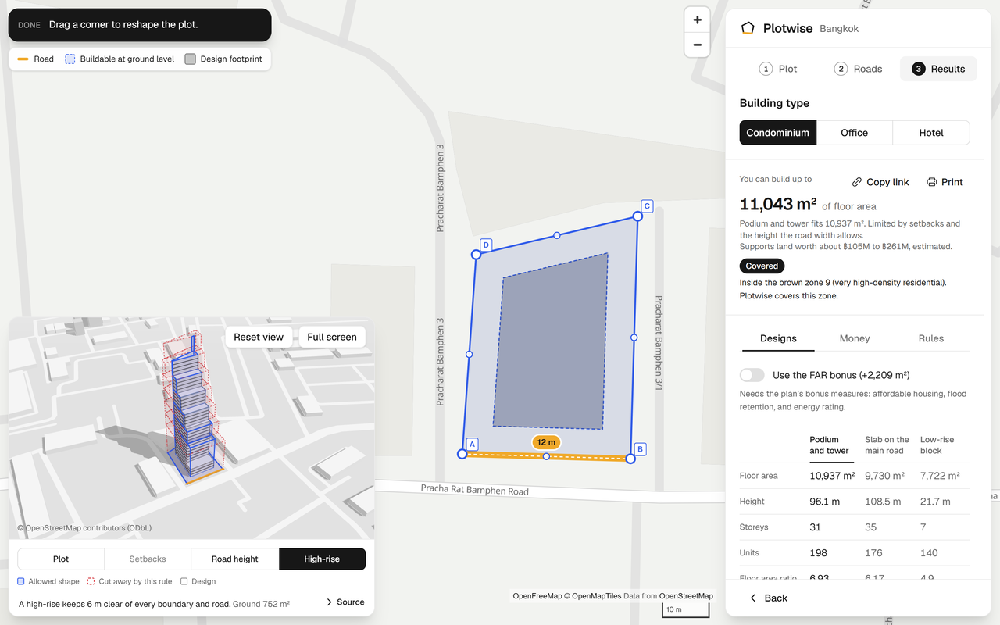
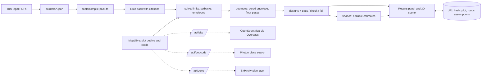

<p align="center"></p>

<h1 align="center">Plotwise</h1>

<p align="center">See what a Bangkok plot can hold before you buy it: the floor area the rules allow, concept designs in 3D, what is left to check and a rough first cost.</p>

<p align="center"><a href="https://plotwise-ashy.vercel.app"><b>plotwise-ashy.vercel.app</b></a> · <a href="https://plotwise-ashy.vercel.app/app">open the app</a></p>

<p align="center"><a href="https://github.com/kunalgoesbyken/plotwise/actions/workflows/ci.yml"></a> <a href="LICENSE"></a></p>

<p align="center"></p>

## For reviewers

### A 60-second tour

1. Open the [landing page](https://plotwise-ashy.vercel.app) and choose **Try the example plot**. The app opens with a worked example, so the results are already there.
2. In **Designs**, compare up to three concepts side by side. Each has a pass / check / fail list, and the **to check** items say why they cannot be confirmed and who signs them off.
3. In **Rules**, step through the setbacks and the road-height rule and watch each one carve the allowed shape in 3D. Every limit links to the page and line of the regulation it comes from.
4. In **Money**, change any assumption. Each shows its source, and the figures are labelled as estimates.
5. Use **Share** to copy a link that holds the whole result, or **Print** for a one-page summary.
6. Back at the start, search an address and click the corners of your own plot.

### Architecture



Solid arrows are deterministic code that runs in the browser. Dotted arrows are server routes that proxy a free public service, each with input validation, CDN caching and a per-IP rate limit.

### Key decisions and trade-offs

- **Rule values are compiled from the official PDFs, never typed.** Each value keeps its page, line and Thai quote, so a reviewer can check it against the source. The price is that adding a rule means writing a pointer, and the pack schema still has Thai-law shapes.
- **No model runs at runtime.** Areas, limits and costs are computed by tested code, so they cannot be invented. The price is that there is no free-text input beyond the place search.
- **The share link is the URL hash.** There is no account or database, and the whole state (plot, roads, building type, assumptions) lives in the hash, which browsers never send to a server. The plot is not kept anywhere, but it is not private from the routes either: `/api/zone` receives the plot outline to check the zone and `/api/site` receives its bounding box to load the surroundings. The price is that a shared link cannot show a preview of its own plot, so every link unfurls with the same card.
- **A static Content Security Policy with inline scripts allowed.** A nonce-based policy makes every page render per request, which turns off the static shell and CDN caching ([Next.js guide](https://nextjs.org/docs/app/guides/content-security-policy)). Instead the policy limits every other source to the site itself and the map-tile host, and forbids objects, framing and foreign form targets.
- **Free services only, so the routes protect them.** Overpass, Photon and the BMA layer are public and slow at times. Answers are cached hard and each route allows 60 (search), 30 (zone) or 20 (site) requests a minute per client. The limits live in memory, so they apply per server instance.
- **Estimates stay editable.** Cost, sales value and land value are first-look figures on assumptions with sources, not valuations.

### What is verified and what is estimated

| Verified | Estimated |
|---|---|
| Rule values, compiled from the PDFs with page, line and quote; ranges, band gaps, cross-source agreement and bonus caps are checked by `tools/check-pack.ts` | Road widths (from OSM lanes or road class, not the legal right-of-way) |
| Setbacks, floor-area limits, envelopes and design checks, by `bun test` unit and property tests | Building heights and station distance (partial OSM coverage) |
| Input validation on every server route, the rate limiter, the share-link encoding | Saleable area, first cost, sale value and the land value a design supports |
| The interface in a real browser: map, 3D view, layouts, performance and security headers, by Playwright | The zone verdict, which comes from the live BMA layer and is shown as unchecked when it cannot be reached |

### Known limits

- **One zone.** The zone check needs the BMA city-plan service, which answers only from Thai networks. Elsewhere the app says the zone was not checked and links the official map.
- **Money figures are first-look estimates, not valuations.**
  - The build rates are Plotwise estimates with no published source for each element (`NO_BKK_COST`). Their total is only cross-checked against RHLB (Siam) Ltd.'s July 2025 range for residential condominiums.
  - The land costs (holding, finance on the land) and the area distances are Plotwise estimates, unsourced. The transfer fee comes from published fee rules.
  - Condo sale prices come from Knight Frank's average asking prices by area, and the margin from a listed developer's report. Office and hotel prices are not split by area.
  - The land check compares against listing and broker figures, which are asking prices.
  - Every value is editable and travels in the share link.
- **OSM coverage.**
  - Heights exist for about a third of central Bangkok buildings, and roads carry no width tags, so widths come from lanes or road class.
  - Road widths are carriageway estimates, not the legal right-of-way, so they stay editable and labelled.
  - Station distance comes from OSM platforms. Coverage is partial: BTS 52 of 64, MRT 15 of 52, and the monorail lines 1 of 55.
- **Road-network continuity** and planned road widenings are not in any open dataset used here. They appear in the "to check" list.
- **The 2026 amending bylaw's** body text could not be machine-read.
- **Rate limits are per server instance.** A serverless platform can run several instances, each with its own counters, so the real ceiling is higher than the numbers above. The limits stop a runaway script from exhausting the free upstream services. They are not an abuse defence.
- **The security policy allows inline scripts**, as explained above.

## What it does

The app takes three steps:

1. **Plot.** Find the site with live place search, then trace its outline on the map, or start from the example plot.
2. **Roads.** Edges beside a mapped road are pre-marked with an estimated width. You can change any of them.
3. **Results.** The results show:
   - the floor area the rules allow, with the optional FAR bonus;
   - up to three concept designs side by side, each with built-up area, saleable area, parking levels, first cost and supported land value;
   - a pass / check / fail checklist with a clickable "to check" list that says why each item needs checking and who confirms it;
   - how the result changes if the road is 2 m narrower or wider;
   - the rules that apply, with their legal sources;
   - the allowed envelope in 3D among the real surrounding buildings.

Every edit updates the results live. The share link holds the plot, the roads, the building type, the FAR bonus switch and any edited assumption. **Print** gives a one-page summary.

Scope: the brown zone (very high-density residential, coded ย.9) of the Bangkok Comprehensive Plan B.E. 2556, for condominiums, offices and hotels. The landing page is at `/` and the app is at `/app`. Old share links on the root still open in the app.

## How it works

1. **Rules are compiled, never typed.**
   - `pointers/bkk-y9.json` points at a page, a line and a token in the text of each source PDF in `sources/`.
   - `tools/compile-pack.ts` parses the Thai number at that spot (Thai digits and number words included) into `src/rules/packs/bkk-y9.json`.
   - Every value keeps its citation: source, clause, page, line and the Thai quote. The interface names each source in English with its page and line, and links the official PDF.
   - `tools/check-pack.ts` checks ranges, band gaps and overlaps, cross-source agreement and bonus caps. It fails on any undecided interpretation question.
2. **Interpretations are decided by a person.** Where the law is ambiguous, the pack holds a question with its candidate readings. The engine refuses to run until each one has a recorded decision.
3. **Solve.** `src/solve` turns the plot and the pack into limits: FAR (standard or with the bonus), open space, use conditions and parking.
   - It also produces per-edge setbacks that change with height: road setbacks by road width, neighbour setbacks, the height-to-road rule and the 6 m high-rise distance.
   - There are two envelopes, ordinary and high-rise.
4. **Geometry.** `src/geometry` builds each envelope from the real outline, with tiers clipped by clipper2-ts. It works for any polygon, including concave and multi-piece outlines.
5. **Designs.** `src/designs` generates podium-and-tower, slab and low-rise block concepts inside the envelope. Each gets a checklist computed from its own geometry. Items the data cannot confirm are marked "check".
6. **Money.** `src/finance` estimates:
   - saleable area, and parking levels above ground and in basements;
   - a first-cost range split into substructure, superstructure and services;
   - the land value each design supports (a residual), after the buyer's transfer fee, holding cost and finance on the land;
   - a check of that land value against typical asking prices for the plot's area.

   The condo sale price and the asking-price reference depend on the plot's area: central Bangkok (CBD), city fringe or suburban, set by straight-line distance from Ratchaprasong. If the area cannot be told, the city fringe values are used.

   Every rate and price is an editable assumption with its source, shown as "estimated". None of it is law.
7. **Site, search and zone.** Server routes proxy OpenStreetMap (Overpass), Photon and the BMA city-plan layer, with input validation at the boundary, caching and a per-IP rate limit. Road widths, building heights, station distance and the zone verdict are labelled as estimates or as unchecked, and stay editable.

## Region and design system

- **Region.** Everything specific to a jurisdiction lives in one record, `src/region/regions.ts`:
  - the rule pack, city and country names, zone label and authority;
  - city-plan link and version, and the local name for the floor area ratio;
  - map start, search bounds and bias;
  - OSM transit tags.

  Money defaults, with the currency and the land unit, are in `MONEY_REGIONS` in `src/solve/assumptions.ts`, and the zone layer is in `src/zone/sources.ts`, both keyed by region. `NEXT_PUBLIC_REGION` picks the active region.

  A rule pack is built from blocks in `src/rules`: FAR from the zone, from a road width × plot size table or given per plot, a capped bonus, purchasable FAR (premium, transferable rights), height caps in metres or storeys, road and boundary setbacks by height and road width, coverage, open space, parking, road widening and use conditions. Most blocks are optional. A value the user enters carries its own cite and makes the result unverified, and a verified pack cannot hold one. Adding a city is a data change when its rules fit these blocks: a rule pack, a region record, money defaults and a zone source.
- **Design tokens.** Colours, fonts, radii, type scale, shadows and motion are defined once in `src/app/globals.css` (`@theme`). The map and the 3D scene read the same tokens at runtime. Components use token names only. The UI uses Geist, Phosphor icons and shadcn/ui on Radix.

## Setup

Requires [bun](https://bun.sh) 1.4 or later. No API keys or environment variables are needed.

```sh
bun install
bun run dev            # http://localhost:3000 (landing), /app (the app)
```

| Task | Command |
|---|---|
| Unit and property tests for the numbers: rules, geometry, solver, designs, site data, input validation | `bun test` |
| Browser tests (local production build; `E2E_PORT` picks the port, default 3123) | `bun run build && bun run e2e` |
| Browser tests against the live site | `E2E_URL=https://plotwise-ashy.vercel.app bun run e2e` |
| Real-GPU performance numbers (default headless is a software renderer) | add `E2E_GPU=1` |
| Recompile / check the rule pack | `bun tools/compile-pack.ts bkk-y9` / `bun tools/check-pack.ts bkk-y9` |
| Type check and lint | `bun run typecheck` and `bun run lint` |

CI (`.github/workflows/ci.yml`) runs on every push to main and every pull request: type check, lint and `bun test` (without the two timing files), the timing job, then the production build and the Playwright suite in headless Chromium with software WebGL. Frame-rate assertions are skipped on a software renderer. The two millisecond-budget files (`performance.test.ts`) run in their own CI job, so a slow shared runner shows up as a failure of that job alone and the budgets are never loosened. The suite needs the internet: OpenFreeMap tiles load live, the cache-header test calls live Photon and skips itself when it is unreachable, and tests that do not mock `/api/zone` query the BMA layer, which answers "not checked" outside Thailand. Overpass is always mocked. On failure the Playwright report is uploaded.

## Code layout

Feature-first folders under `src/`:

| Folder | Responsibility |
|---|---|
| `editor` | The three-step panel, drawing and editing the plot on MapLibre, roads, building type, live place search, URL state |
| `plot`, `geo` | The validated plot contract and the local metric projection |
| `rules` | Rule pack building blocks, schema and loader |
| `solve` | Rules → limits, setbacks by height, envelopes; `assumptions.ts` holds every engineering and money assumption with its source |
| `geometry` | Polygon normalization, per-edge setback envelopes, tiers, floor plates |
| `designs` | Concept designs, metrics and checklists |
| `finance` | Saleable area, parking levels, first cost, land value, the assumptions panel and their share-link encoding |
| `feasibility` | Runs solve + designs once for every panel; Designs, Rules, to-check, road-width sensitivity, FAR bonus, share |
| `region` | The active jurisdiction as data |
| `zone` | City-plan zone lookup through the BMA ArcGIS layer |
| `site` | Overpass proxy, OSM parsing, height and width estimates, nearest-road and nearest-station suggestions |
| `geocode` | Place search through Photon |
| `scene` | three.js / react-three-fiber view of the context, envelope and designs |
| `report` | The one-page printable summary |
| `landing` | The landing page, built from the real example plot's figures |
| `ui` | shadcn/ui components on Radix, the logo, and shared panel pieces |
| `text` | One typed message dictionary and the number formatter |
| `rate-limit` | The per-IP limiter shared by the three API routes, and their limits with the reasoning |
| `security` | The Content Security Policy and the other response headers |
| `seo` | The site address, the share-card colours and the page metadata helper |

## Sources

- Bangkok Comprehensive Plan B.E. 2556 (Ministerial Regulation, Royal Gazette) and its 2013 correction
- Bangkok bylaw of 13 March 2026 amending the plan (text layer unreadable; treated as factory-only, shown with a note)
- Ministerial Regulations 55 (building setbacks, open space, height vs road), 33 (high-rise and extra-large buildings) and 7 (parking)
- Bangkok Building Control Bylaw B.E. 2544
- BMA City Planning GIS, comprehensive plan 2556 land-use layer (queried live, not stored)
- © OpenStreetMap contributors (ODbL); base map by OpenFreeMap / OpenMapTiles
